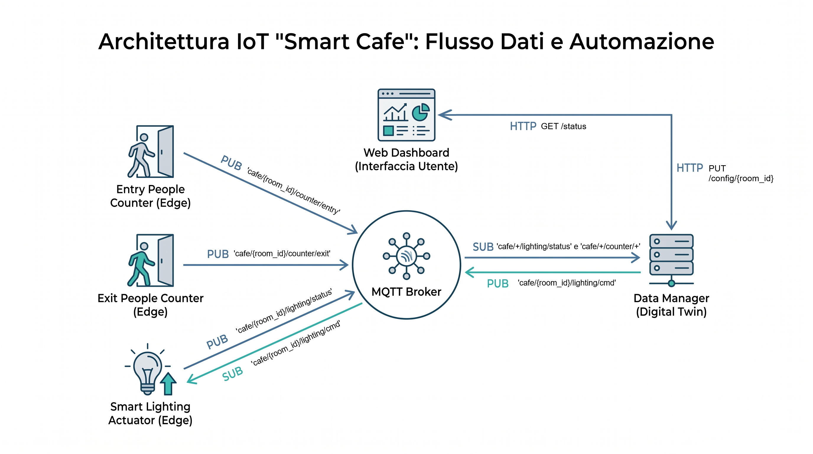

# Smart Cafe: Occupancy-Based Lighting Automation

> A hybrid IoT system for real-time monitoring and intelligent lighting automation based on room occupancy.  
> The system uses a distributed network of sensors and actuators to optimize comfort and energy efficiency through a **Digital Twin** architecture.

**Project for the "Intelligent Internet of Things" course**  
Bachelor's Degree in Computer Engineering — University of Modena and Reggio Emilia (UNIMORE) — A.Y. 2025/2026  
Author: Hartaj Bajwa Singh (189062) — 333979@studenti.unimore.it

---

## Table of Contents

1. [High-Level Architecture & Main Components](#high-level-architecture--main-components)
2. [Project Structure](#project-structure)
3. [System Features](#system-features)
4. [Data Models](#data-models)
5. [Protocols & Communication](#protocols--communication)
   - [MQTT Topic Design](#mqtt-topic-design)
   - [RESTful API (HTTP)](#restful-api-http)
6. [How to Run](#how-to-run)

---

## High-Level Architecture & Main Components

The system adopts a hybrid and distributed architecture, illustrated in detail in the diagram below:




## Project Structure


```
IoT Progetto Smart Cafe/
├── model/               # Domain definitions (CafeRoomState, device classes)
├── dto/                 # Data Transfer Objects (RoomStatusDTO)
├── resources/           # REST interfaces (API Controller: StatusResource, ConfigResource)
├── processes/           # Independent executable processes
│   ├── data_manager_process.py   # Digital Twin + Flask Server
│   ├── actuator_process.py       # Lighting actuator (MQTT subscriber)
│   └── counter_process.py        # People counter sensor (MQTT publisher)
├── requirements.txt
├── README.md
└── Architettura_IoT_Smart_Cafe.png
```

---

## System Features

### Adaptive Automation
Brightness regulation via a **saturating exponential curve**:

$$L = 40 + 30 \times (1 - e^{-k \cdot n})$$

where:
- **L** = brightness level (%, range 40–70%)
- **n** = number of people currently in the room
- **k** = configurable reactivity parameter (range 0.05 – 0.5)

> **Physical justification:** The formula mirrors the Beer-Lambert law of light absorption, modeling the non-linear occlusion of light caused by human crowding.

### Dynamic Digital Twin
Management of **n rooms** through automatic creation of `CafeRoomState` objects upon receiving the first MQTT message. No static configuration is required.

### Data Resilience
Use of **cumulative counters** (SenML) to ensure state realignment even in case of lost packets. The number of people present is computed as:

```
current_people = last_entry_total - last_exit_total
```

### Health Check (Heartbeat)
**Online/offline** monitoring system for actuators. Each actuator publishes `{"status": "online"}` on the topic `cafe/{room_id}/lighting/status` every **5 seconds**. The DataManager records the timestamp of the last heartbeat and uses it to determine actuator availability in the `GET /status` response.

### Thread-Safety
Concurrent access is protected by a `threading.Lock` (`_lock`) between the DataManager's MQTT thread (writer) and the Flask server (reader/writer).

---

## Data Models

Data exchange occurs in **JSON** format following the **SenML** standard.

### Counter Telemetry Model (SenML + JSON)

Published by `counter_process.py` on `cafe/{room_id}/counter/{entry|exit}`:

```json
[
  {
    "bn": "urn:dev:mac:counter-room1-entry",
    "n": "cumulative_count",
    "u": "count",
    "v": 42,
    "t": 1750852800
  }
]
```

| Field | Name (`n`) | Unit (`u`) | Type | Description |
|:---|:---|:---|:---|:---|
| `v` | `cumulative_count` | `count` | Int | Historical total of detected passages |
| `t` | — | `s` | Long | Unix Timestamp of the detection |

### Lighting Command Model (SenML + JSON)

Published by `data_manager_process.py` on `cafe/{room_id}/lighting/command`:

```json
[
  {
    "bn": "urn:dev:mac:actuator-room1",
    "n": "brightness_level",
    "u": "%",
    "v": 58.5
  }
]
```

| Field | Name (`n`) | Unit (`u`) | Type | Description |
|:---|:---|:---|:---|:---|
| `v` | `brightness_level` | `%` | Float | Brightness level (Range: 40–70%) |

### Heartbeat Model (JSON)

Published by `actuator_process.py` on `cafe/{room_id}/lighting/status` every 5 seconds:

```json
{"status": "online"}
```

---

## Protocols & Communication

### MQTT Topic Design

The topic structure strictly separates publication (concrete topics) from subscription (wildcards for scalability):

| Component | Action | Topic Pattern | Note |
|:---|:---|:---|:---|
| Entry Sensor | **PUB** | `cafe/{room_id}/counter/entry` | Concrete topic (e.g. `room1`) |
| Exit Sensor | **PUB** | `cafe/{room_id}/counter/exit` | Concrete topic |
| Actuator | **PUB** | `cafe/{room_id}/lighting/status` | Heartbeat "online" every 5s |
| Actuator | **SUB** | `cafe/{room_id}/lighting/command` | Receives brightness commands |
| Data Manager | **SUB** | `cafe/+/counter/+` | Listens to all sensors (wildcard) |
| Data Manager | **SUB** | `cafe/+/lighting/status` | Listens to all heartbeats (wildcard) |
| Data Manager | **PUB** | `cafe/{room_id}/lighting/command` | Sends command to a specific room |

> **QoS:** All critical messages (lighting commands, heartbeats) use `qos=1` (at least once).

### RESTful API (HTTP)

The API is exposed by the Data Manager on port **5000**:

#### `GET /status`
Returns the complete DTO of all monitored rooms.

**Response 200:**
```json
{
  "room1": {
    "room_id": "room1",
    "current_people": 5,
    "current_brightness": 58.5,
    "k": 0.2,
    "actuator_online": true
  }
}
```

#### `PUT /config/{room_id}`
Dynamically updates the reactivity parameter `k` for a specific room.

**Request body:**
```json
{ "k": 0.3 }
```

**Responses:**
| Code | Meaning |
|---|---|
| `200` | Parameter `k` updated successfully |
| `400` | Missing `k` field or value out of range (0.05 – 0.5) |
| `404` | Room not found |
| `500` | Internal server error |

---

## How to Run

### Prerequisites

Install Python dependencies:

```bash
pip install -r requirements.txt
```

Make sure an MQTT broker (e.g. **Mosquitto**) is running on `localhost:1883`:

```bash
# On Windows with Mosquitto installed:
mosquitto

# Or with Docker:
docker run -it -p 1883:1883 eclipse-mosquitto
```

> **Important:** Always run all commands from the **project root directory** (do not navigate into the `processes/` folder in the terminal).

---

### Start-up Order (4 separate terminals)

#### 1. Central Server (Data Manager)

The heart of the system. Maintains state in RAM, exposes the HTML Dashboard, and processes MQTT messages.

```bash
python processes/data_manager_process.py
```

> After startup, the dashboard will be available at **http://localhost:5000/**

---

#### 2. Smart Lighting Actuator (Room 1)

Start the actuator for the desired room. It will send a heartbeat every 5 seconds to the DataManager.

```bash
python processes/actuator_process.py room1
```

> You can start as many actuators as needed for different rooms by changing the ID:  
> `python processes/actuator_process.py room2`

---

#### 3. Entry Counter (Room 1)

Simulates random person entry passages.

```bash
python processes/counter_process.py room1 entry
```

---

#### 4. Exit Counter (Room 1)

Simulates random person exit passages.

```bash
python processes/counter_process.py room1 exit
```

---

### Monitor

Open your browser at **http://localhost:5000** to access the global dashboard, which displays in real time:
- Number of people per room
- Current brightness level
- Online/offline status of actuators
- Current reactivity parameter `k`

---

### Updating the `k` parameter (Reactivity)

Dynamically change the light reactivity to occupancy via the REST API (allowed values: **0.05 – 0.5**):

**Windows PowerShell:**
```powershell
Invoke-RestMethod -Uri "http://localhost:5000/config/room1" -Method Put -ContentType "application/json" -Body '{"k": 0.3}'
```

**Windows (curl.exe):**
```powershell
curl.exe -X PUT localhost:5000/config/room1 -H "Content-Type: application/json" -d "{\"k\":0.3}"
```

**Linux / macOS:**
```bash
curl -X PUT localhost:5000/config/room1 -H "Content-Type: application/json" -d '{"k":0.3}'
```
